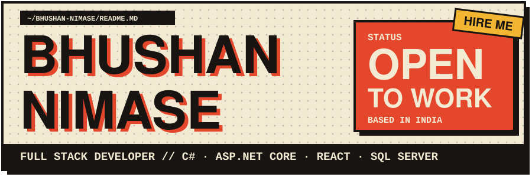


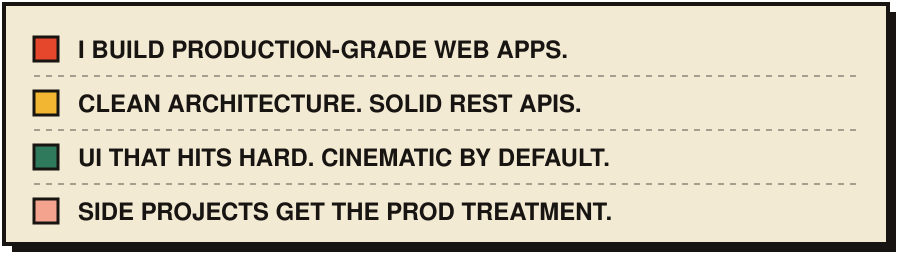


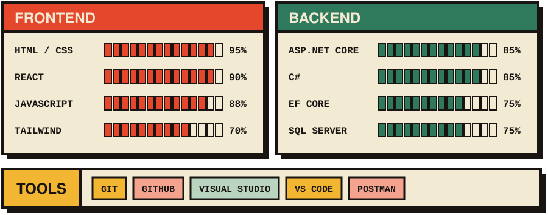

<div align="center">

```
   ▄▄          ▄▄
  ████▄▄▄▄▄▄▄▄████
 ██████████████████
 ███ ●  ████  ● ███
 ██████████████████
 ██ ▀▄▄▄▄▄▄▄▄▄▄▀ ██
  ▀██▄  ▀▀▀▀▀▀  ▄██▀
   ▀███▄▄▄▄▄▄███▀
    ██▀        ▀██

 GENGAR.EXE // HAUNTING LEGACY CODE
```

</div>

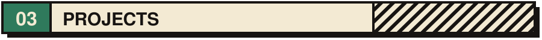

<a href="https://github.com/Bhushan-Nimase/Movie-Db">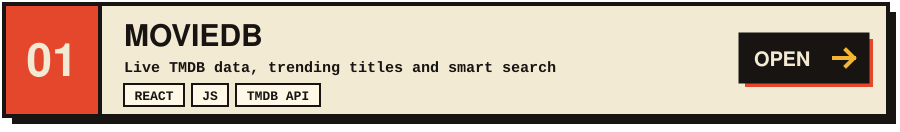</a>

<a href="https://github.com/Bhushan-Nimase/core">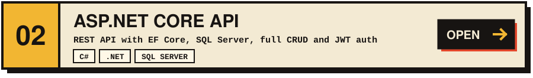</a>

<a href="https://github.com/Bhushan-Nimase/Netflix-clone">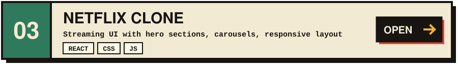</a>

<a href="https://github.com/Bhushan-Nimase/OnlineShop">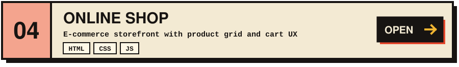</a>

<a href="https://github.com/Bhushan-Nimase/CoffeeShop">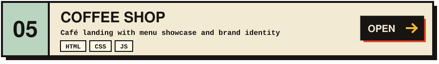</a>

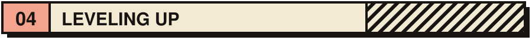

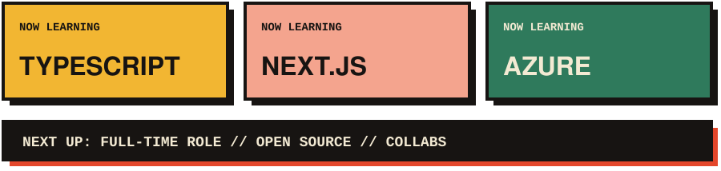


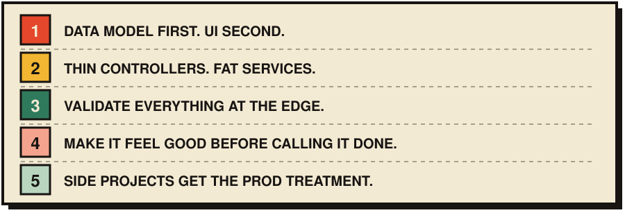


<div align="center">

<a href="https://linkedin.com/in/bhushan-nimase"></a>
<a href="https://github.com/Bhushan-Nimase"></a>
<a href="mailto:your-email@gmail.com"></a>
<a href="https://your-portfolio-url.vercel.app"></a>

</div>

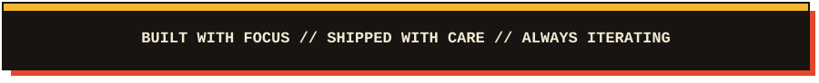
